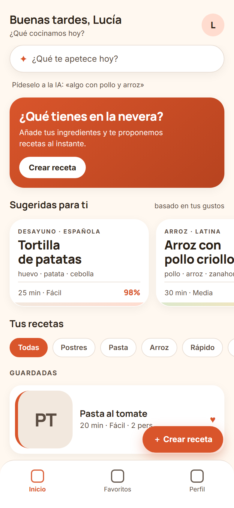
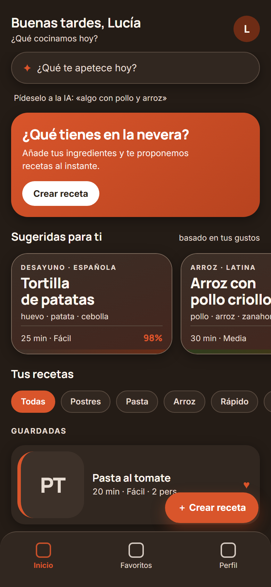
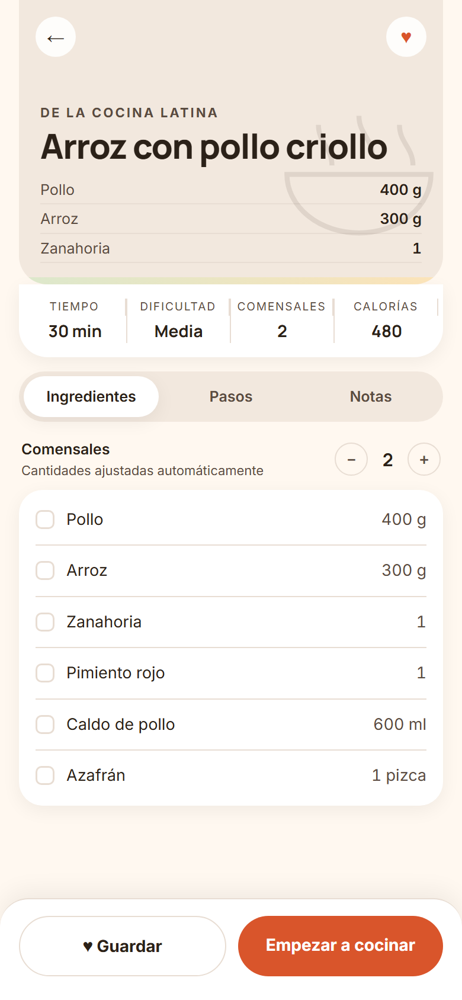
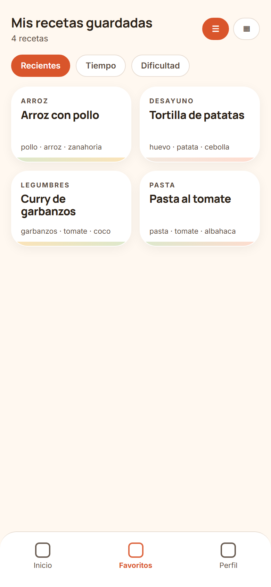
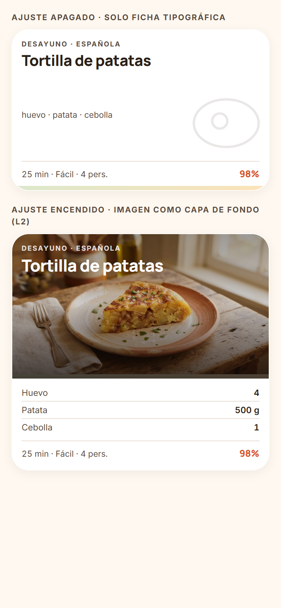
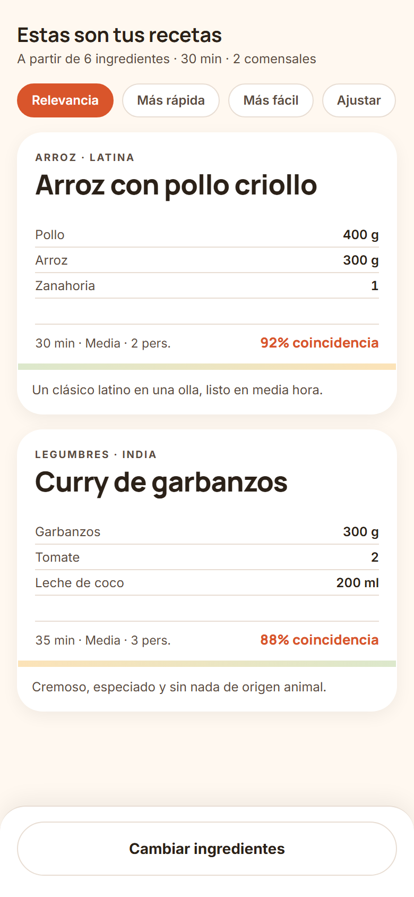
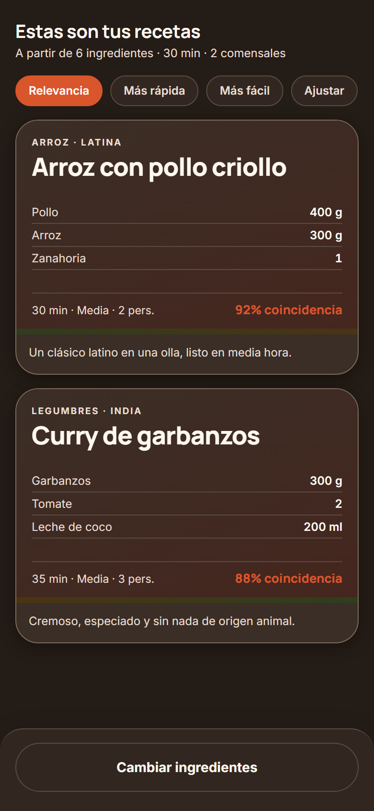

<!-- _class: lead -->
<!-- _paginate: false -->

# Sazón

## SDD, harness e IA aplicados a un proyecto personal Android

**77 features · 76 aceptadas · 100 PRs · 967 tests · 8 ADRs**

Del descubrimiento al MVP, feature a feature, con verificación independiente.

---

## Sazón en 60 segundos

Convierte los ingredientes que **ya tienes en casa** en recetas completas generadas con IA, respetando las **restricciones duras** de forma **verificable**.

- **MVP (corte vertical):** Onboarding → Home → Generador → **Validación** → Resultados → Detalle → Favoritos → Perfil
- **Decisiones:** local-first sin backend (ADR 0002), Taxonomía en código (ADR 0001), **modo semilla** sin clave de IA
- **Stack:** Kotlin + Compose (Material 3), Room, Ktor/OkHttp, `minSdk 33`

`docs/build-brief.md` · `CONTEXT.md` · `docs/domain-model.md` · `docs/technical-discovery.md`

---

## Cómo se ve

<div class="row">




</div>

<figcaption>Home (claro y oscuro) · Detalle · Favoritos — capturas del diseño aceptado</figcaption>

---

<!-- _class: divider -->

## Parte 1 — Cumplimiento del proceso

*Elemento del curso → qué hicimos → evidencia.*

---

## Mapa curso → proyecto → evidencia (1/2)

| Elemento del curso | Qué hicimos | Evidencia |
|---|---|---|
| `build-brief` (discovery guiado) | Entrevista 1-a-1: problema, usuarios, MVP, no-goals, riesgos | `docs/build-brief.md`, `CONTEXT.md` |
| Vocabulario / glosario | Glosario vivo con términos **rechazados** (anti drift) | `CONTEXT.md` |
| `harness-starter` | Derivamos los 4 artefactos obligatorios | `AGENTS.md`, `init.sh`, `PROGRESS.md`, `feature_list.json` |
| `feature_list.json` | 77 features con `depends_on`, `verification`, `evidence`, `status` | `feature_list.json` |
| Ciclo de vida | 76 recorrieron el ciclo completo; 1 en `blocked` | `feature_list.json`, `PROGRESS.md` |
| `feature-spec` (**planner**) | 76 specs implementables, nunca PRDs ni código | `docs/specs/` (76) |
| `feature-implementer` (**generator**) | Código + autoverificación + evidencia | `PROGRESS.md` |
| `feature-validator` (**evaluator**) | Contexto limpio, re-ejecuta el gate | `docs/validations/` (52) |

---

## Mapa curso → proyecto → evidencia (2/2)

| Elemento del curso | Qué hicimos | Evidencia |
|---|---|---|
| `feature-intake` | Alta de features y correctivas: formato único, ids y dependencias | `.opencode/skills/feature-intake/` |
| `feature-flow` | planner→implementer→validator + commit local al accept | ramas `feature/<id>` |
| `github-flow` | Issue `[<id>]`, rama, worktree, sesión, PR | **100 PRs** |
| `pr-flow` + `reviewer` | Revisión independiente del PR y **merge** con puerta | `.opencode/skills/pr-*` |
| Worktrees + sesiones paralelas | Una feature por worktree/sesión | `scripts/new-worktree.sh`, `scripts/launch-feature-session.sh` |
| Subagentes y permisos | Rol por subagente con `edit`/`shell` acotados | `.opencode/agent/*` |
| Comandos | `/spec`, `/implement`, `/validate`, `/feature`, `/review-pr` | `.opencode/command/` |
| Verificación estándar | `bash init.sh` = test + lint | `init.sh`, `scripts/gradle.sh` |
| Memoria del proceso | Estado + registro de sesiones (hasta la 148) | `PROGRESS.md` |
| ADRs | Decisión con estado y reversiones | `docs/adr/` (0001–0008) |

---

## Panel de estado

<div class="cols">
<div class="card">

**Features**
- 77 planificadas
- **76 `accepted`**
- **1 `blocked`**
- 0 `in_progress` · 0 `passing` (WIP = 0)

</div>
<div class="card">

**Volumen**
- 76 specs · 52 validaciones
- 100 PRs · 322 commits
- 8 ADRs
- 2026-09-22 → 2026-10-19

</div>
</div>

**Gate:** 117 suites / **967 tests** / 0 fallos · lint **0 errores**

---

## Cobertura: áreas y corte vertical

**Distribución por área** — `ui 39 · integration 21 · domain 7 · data 7 · platform 3`

**Corte vertical completo, todo `accepted`:**

Onboarding · Home · Generador · **Validación** · Resultados · Detalle · Favoritos · Perfil

> El **MVP está cerrado** de punta a punta. Cero features a medias.

---

## Worktrees: una feature por rama, y en paralelo

`scripts/new-worktree.sh <id>` → worktree propio fuera del checkout base + rama `feature/<id>`, y una **sesión opencode independiente** por worktree (`scripts/launch-feature-session.sh`).

```text
main ──┬─ feature/A  → worktree A  → sesión opencode A ─┐
       ├─ feature/B  → worktree B  → sesión opencode B ─┤→ planifican/implementan/validan
       └─ feature/C  → worktree C  → sesión opencode C ─┘   a la vez, sin colisiones
```

- **Aislamiento:** cada sesión trabaja en su directorio y su rama; no se pisan ficheros.
- **El orquestador (`github-flow`) es el único integrador:** trae `origin/main` con **merge** (nunca rebase/force-push) y resuelve los artefactos compartidos (`feature_list.json`, `PROGRESS.md`).
- **Publicación:** al `accept` → push + **PR** (issue, rama y PR con el mismo `id`). El **merge** lo hace después el orquestador **`pr-flow`**, nunca quien publica.

*Evidencia: `scripts/new-worktree.sh`, `scripts/launch-feature-session.sh`, `scripts/sync-worktree.sh`, 100 PRs.*

---

## El flujo completo: de la idea al merge

**Tres orquestadores encadenados; una sola autoridad de merge.**

```text
idea → feature-intake → feature-flow ─────────► github-flow ─────► pr-flow
       alta en el plan  spec → implement → validar  issue → rama → PR  reviewer → merge
       (commit local)   (commit local, nunca push)  (nunca merge)      (única autoridad)
```

| Fase | Skill | Subagente | Produce | Nunca hace |
|---|---|---|---|---|
| Dar de alta | `feature-intake` | — | entrada en `feature_list.json` | spec · código · push |
| Especificar | `feature-spec` | `planner` | `docs/specs/<id>.md` | código |
| Implementar | `feature-implementer` | `implementer` | código + autoverificación | commit · push · PR |
| Validar | `feature-validator` | `validator` | veredicto `accept` | merge |
| Publicar | `github-flow` | — | issue · rama · worktree · **PR** | merge |
| Revisar y mergear | `pr-flow` (`pr-review`) | `reviewer` | revisión + **merge commit** | squash · rebase · force-push |

---

## Revisar un PR: el `reviewer` (skill `pr-review`)

Revisión **independiente** de un PR ya abierto: no se fía del resumen de quien lo implementó; juzga contra el **diff real**, la spec y las reglas del repositorio.

- Comprueba objetivo/no-goals, **disciplina de alcance**, formato del PR (`[<id>] …` con `Closes #<n>`) y `DESIGN.md` en features de UI
- **Re-ejecuta el gate** (`bash init.sh`) y comprobaciones focales en el worktree del PR
- Reutiliza el rubric y el checklist de seguridad de `feature-validator` (sin duplicarlos)
- **Solo lee:** `edit` denegado; sin commit, push, merge ni tocar el PR. Los conflictos los **detecta**, no los resuelve
- Un veredicto: **`accept` / `revise` / `block`** + estado de conflictos (`none` / `behind` / `conflicting`) + brief de reparación

`/review-pr [nº|id]` · `.opencode/agent/reviewer.md` · `.opencode/skills/pr-review/SKILL.md`

---

## Merge con puerta: solo `pr-flow`

- `pr-flow` es la **única autoridad de merge**; opera sobre los PRs ya abiertos por `github-flow`
- Por PR: sincroniza la base → revisa (`reviewer`) → repara un `revise` con `implementer` (**máx. 2 rondas**) → merge o bloqueo
- **Conflictos:** los resuelve el orquestador (único integrador) manteniendo **ambas** aportaciones; si exigen criterio de código, se delega en `implementer`

**Puerta de merge (todas a la vez):** `accept` del reviewer · `MERGEABLE` sin conflictos · sin checks requeridos en rojo · head empujado · `Closes #<n>` en el cuerpo.

**Método:** `gh pr merge <n> --merge` (**merge commit**). Nunca `--squash`, `--rebase`, `--auto` ni force-push.

> Sesión 131: el merge **deja de ser manual** y pasa a `pr-flow`, siempre con el gate por delante. Tras mergear, `github-flow prune` limpia worktree/rama (nunca forzado).

`.opencode/skills/pr-flow/SKILL.md` · `.opencode/command/review-pr.md` · `scripts/pr-worktree.sh`

---

<!-- _class: divider -->

## Parte 2 — Integración de IA

*DevExpert + proveedor de chat, a fondo.*

---

## Una frontera, dos cadenas

El dominio **no depende de ningún SDK**: depende de **dos puertos puros**.

| Puerto (dominio) | Operaciones | Adaptador real |
|---|---|---|
| `RecipeGenerator` | sugerir · buscar · generar | `data/ai/DevExpertRecipeGenerator` |
| `DishImageGenerator` | `generate(request): ByteArray?` | `data/ai/image/DevExpertDishImageGenerator` |

- En tests: `FakeRecipeGenerator` (**sin red, sin Android**).
- El proveedor queda **aislado** en una capa sustituible.

---

## Chat: DevExpert → OpenCode Go (con motivo)

- **Origen:** `real-ai-provider` conectó el proveedor real contra **DevExpert Inference** (ADR 0003).
- **Evolución:** se **agotó la cuota semanal** de DevExpert → correctiva **`chat-provider-opencode-go`** movió **solo el chat** a **OpenCode Go** (`deepseek-v4.1-flash`).
- **Decisión fina:** la **base URL de la imagen se desacopló** para que el cambio de chat **no arrastrara** las imágenes a un proveedor donde fallarían **en silencio**.

`docs/adr/0003-ai-provider.md` · `data/ai/AiProviderPolicy.kt` · `data/ai/OpenAiChat.kt`

---

## Chat: el camino de una respuesta

1. `PromptBuilder` (puro) construye el prompt desde el Perfil
2. `OpenAiChat` (Ktor + OkHttp) · timeouts y reintentos en `AiProviderPolicy`
3. `response_format: json_object` con **fallback one-shot** ante 400/422 (nunca > 2 intentos)
4. **Decodificación tolerante** (`AiRecipePayload` / `AiRecipeIds`): completa `id` = `ai-<sha256>`, `source = ai`, tolera `quantity` nula ("al gusto")
5. **`RecipeValidator` = puerta dura**: descarta lo que incumple Taxonomía o restricciones duras
6. **Diagnóstico** por llamada (`AiDiagnostics` + modo verboso en debug)

---

## Imagen de plato: DevExpert Inference

| Pieza | Detalle |
|---|---|
| Transporte | `POST /images/generations` (`image`) y `POST /images/edits` (`image-edit`, estilo con referencia) |
| Códec | reducción local a **WebP 960 px q80** |
| Caché (3 capas) | memoria (LRU) → disco (`cacheDir/dish-images`, 80 MiB LRU) → **set semilla** → generador |
| Orquestación | `DishImageResolver` con `Mutex` por clave |
| Control de gasto | interruptor "Generar imágenes del plato" + **tope por sesión** |
| Degradación | sin clave o sin imagen → **ficha tipográfica** (nunca rompe la UI) |

`docs/adr/0005-ai-dish-images.md` · `data/ai/image/` · `data/image/`

---

## Dos claves, cero fugas

- `BuildConfig.OPENCODE_API_KEY` (**chat**) y `BuildConfig.DEVEXPERT_API_KEY` (**imagen**)
- Ambas desde `local.properties`, **no versionado**
- Cada consumidor **degrada en silencio** si falta la suya
- **Modo semilla:** la app **arranca y es usable sin proveedor de IA**

> Ninguna clave ni cabecera `Authorization` aparece nunca en logs, ni siquiera en debug.

---

## La imagen generada, en la app

<div class="shot-pair">

</div>

<figcaption>Ficha tipográfica (arriba) e imagen generada como capa de fondo L2 (abajo).</figcaption>

---

<!-- _class: divider -->

## Parte 3 — Evolutivos post-MVP

*Ampliar sin perder trazabilidad.*

---

## Cómo se añade un evolutivo

1. Se documenta una **propuesta** (no aceptada, fuera del MVP)
2. Las **fases se dan de alta como features** con `feature-intake` (`id`, `depends_on`, `verification`)
3. Cada fase recorre el **ciclo normal**: spec → implement → validación
4. Al cerrar, se **actualiza un ADR**

`docs/ai-dish-images-proposal.md` · `docs/backend-proposal.md`

---

## Cómo nace una feature o una correctiva

**`feature-intake`**: del hallazgo a una entrada del plan, con el mismo formato siempre.

1. Se declara **tipo** (feature o correctiva), título, comportamiento visible, área y **dependencias**
2. La skill comprueba que el `id` no existe y que las dependencias están **`accepted`**
3. Redacta `status: not_started` + `verification` + `notes` y **valida el JSON**
4. Commit `chore(plan): alta de …`; `github-flow` la toma ya desde `origin/main`
5. Después, el ciclo normal: `feature-spec` → `feature-implementer` → `feature-validator`

> El alta también es un contrato: no se planifica ni se implementa aquí.

`.opencode/skills/feature-intake/SKILL.md` · `feature_list.json`

---

## Catálogo de evolutivos entregados

| Evolutivo | Qué añadió |
|---|---|
| **Modo cocina** (`cooking-mode`) | Pasos a pantalla completa + temporizador por paso (visual) |
| **Imágenes de plato IA** (7 fases) | Puerto → generador → caché → UI progresiva → ajuste → descriptor → estilo → set semilla |
| **Ficha tipográfica** (ADR 0006) | La tarjeta deja de ser foto: categoría + título + 3 ingredientes + filete de cocina |
| **Búsqueda con IA** (`ai-search`) | Texto libre → IA → **pasa por el Validador** igual que el generador |
| **Sugerencias personalizadas** | Carrusel acotado a 6, seguro y ordenado por relevancia |
| **Descriptor visual** | El modelo emite `dishKey`/`imagePrompt` que alimentan la caché |

---

## Lo propuesto y NO ejecutado (honestidad)

- `docs/backend-proposal.md` (cuenta, sincronización, proxy de IA): documentado y **descartado** por ahora.
- Motivo: **revertiría** el no-objetivo permanente del **ADR 0002** (local-first, sin backend).

> Sabemos separar *idea documentada* de *decisión aceptada*.

---

<!-- _class: divider -->

## Parte 4 — Correcciones de áreas importantes

*El bucle cerrado de calidad.*

---

## Correcciones de integración de IA

Cuando algo falla, **no se parchea a mano**: nace una **feature correctiva** con el mismo ciclo.

| Correctiva | Problema que arregló |
|---|---|
| `ai-provider-timeouts` | Timeouts no ajustados a la latencia real |
| `ai-recipe-decode` | La IA no devuelve `id`/`source`: se completan antes de validar |
| `ai-call-diagnostics` | Falta de observabilidad por llamada |
| `ai-response-format` | Formato JSON de la respuesta (**pasó por `revise`**) |
| `ai-quantity-tolerance` | Ingredientes "al gusto" (`quantity` nula) ya no caen |
| `ai-verbose-diagnostics` | Diagnóstico fino de descartes (debug) |
| `chat-provider-opencode-go` | Cuota de DevExpert agotada → chat a OpenCode Go |

---

## Correcciones de diseño / UI

`recipe-artwork` · `favorites-sort-controls` · `profile-stats-heading` ·
`home-recently-opened-group` · `recipe-card-typographic` · `recipe-detail-typographic-header` ·
`recipe-card-l2-unified` · `favorites-tile-contrast` · `detail-hero-full-bleed` ·
`detail-hero-square-bottom` · `dish-image-settings-default-off`

> Todas `accepted` con validación independiente. Ninguna correctiva quedó abierta.

---

## El caso que prueba que el validador sirve

**`ai-response-format`**

- El validador **independiente** detectó que el *fallback* podía añadir un **tercer intento HTTP** → Finding **Medium**
- El implementer lo **reparó** con test de regresión: `el_fallback_no_anade_un_tercer_intento`
- Re-validación → **`accept`**

> La puerta de calidad **bloqueó un bug real** antes del merge. No es decorativa.

`docs/validations/ai-response-format.md`

---

<!-- _class: divider -->

## Parte 5 — Iteraciones sobre el harness

*Aplicamos SDD al propio método.*

---

## Estable vs. iterado

<div class="cols">
<div class="card">

**Estable (no se tocó durante la implementación)**
- El gate de verificación (`init.sh` = test + lint)
- El ciclo `not_started → accepted`

</div>
<div class="card">

**Iterado con el uso**
- Topología de GitHub (issues/ramas/PRs)
- Política de capturas
- Lanzadores de sesión
- Entorno (WSL)
- Permisos de los subagentes
- Revisor de PRs y política de merge

</div>
</div>

---

## Bitácora de iteraciones del harness

| Iteración | Problema → solución |
|---|---|
| Base para worktrees y PRs | Preparar el repo para `feature/<id>` |
| Skills a `.opencode/skills` | Permisos: evitar acceso externo |
| Planner escribe specs en worktrees | Permisos acotados por rol |
| `github-flow` fija el lanzador | No improvisar wrappers por sesión |
| Cerrar issue en el PR | Trazabilidad: `Closes #<n>` (en inglés) |
| Revisor de PRs (`pr-flow` + `reviewer`) | El merge deja de ser manual: puerta + merge commit |
| Entorno **WSL nativo** | JDK/SDK de Linux + caché en ext4 |
| Gradle no cuelga la shell | Daemons → salida a fichero |
| Capturas: exigir → provisionar → **retirar** | Política móvil → material **opcional** |
| Lanzador foreground → bg → **foreground** (revert) | Evitar sesiones huérfanas |
| Alta de features/correctivas (`feature-intake`) | Formato único + ids/dependencias verificadas antes del flujo |
| Prune de worktrees mergeados | Limpieza segura |

---

## Lección de las iteraciones

- Hubo **reversiones conscientes**: `Revert "chore(github-flow): el agente no lanza sesiones"`.
- Cada iteración es un **commit `chore:*`** separado del trabajo de features.
- **El harness se corrige con el mismo rigor que el producto.**

---

<!-- _class: divider -->

## Parte 6 — Diseño ↔ UI

*Stitch no se copió: se convirtió en tokens verificables.*

---

## Jerarquía de fuentes de verdad

1. **`DESIGN.md`** → **fuente de verdad visual** (tokens + reglas, con frontmatter YAML)
2. **`docs/design/stitch/`** → 23 prompts (contexto, design system, una pantalla cada uno)
3. **`docs/design/concepts/<feature-id>/<pantalla>/`** → export de Stitch (`.png` + `.html` + `design.md`)

> Las capturas son **material opcional**: `DESIGN.md` manda. Su ausencia **no bloquea**.

---

## Del diseño al código (rasgo diferencial)

**`design-tokens-and-theme`**

- Materializa `DESIGN.md` en el paquete `ui/theme`
- **Sin** color dinámico (Material You) · **con** variante oscura
- **Test JVM que compara los tokens de código con el frontmatter de `DESIGN.md`**
- + caso negativo que prueba que el test **no pasa en vacío**

> **El diseño queda verificado por test.**

---

## El sistema de diseño, en claro y oscuro

<div class="shot-pair">


</div>

<figcaption>Mismos tokens, dos temas — comparados contra `DESIGN.md` por un test JVM.</figcaption>

---

## Cómo cada feature de UI consume el diseño

- Cada spec incluye una sección **“Visual Design Impact”**: pantallas/estados, fuente de diseño y capturas necesarias (o desviación autorizada).
- El implementer construye contra `DESIGN.md`; el acabado visual se revisa en emulador **tras el merge**.
- Cuando el diseño cambió (**foto → ficha tipográfica**, ADR 0006) se aplicó con features concretas + una **retirada** (`retire-recipe-photos`).
- **Desviaciones de capturas** documentadas una a una en `DESIGN.md` (#77, #85, #86, #91, #98, #101, #110, #129-#132).

---

<!-- _class: divider -->

## Cierre

---

## Disciplina del proceso (reglas respetadas, con prueba)

- **Una feature por** sesión/worktree
- **Nada se marca hecho sin evidencia** (`PROGRESS.md` por sesión)
- **Roles separados**: el agente principal **delega**, no ejecuta spec/impl./validación
- **Gate fijo**: no se cambian las reglas de verificación durante la implementación
- **Validador independiente**: re-ejecuta (`--rerun-tasks`), parsea XML, compara con baseline de `HEAD`
- **Nunca rebase/force-push, nunca auto-merge**: integra el orquestador; el **merge es de `pr-flow`** y solo con el gate (`accept` + sin conflictos + checks en verde)

---

## Retrospectiva

<div class="cols">
<div class="card">

**Funcionó**
- Harness → trabajo de IA **fiable**
- Validación independiente cazó bugs reales
- Worktrees → paralelismo sin colisiones
- Glosario → sin deriva de vocabulario
- Diseño verificado por test

</div>
<div class="card">

**Mejoraríamos**
- Backfill de validaciones (52/76)
- Backfill de capturas de UI
- Pruebas de UI no automatizadas (WSL/emulador)
- Coste/cuota de IA (mitigado: caché + tope + semilla)

</div>
</div>

---

## Cumplimiento de los objetivos del curso

Contra los criterios del propio `docs/build-brief.md`:

- ✅ **Objetivo 5:** recorrer el **ciclo SDD completo** con el harness
- ✅ Verificación reproducible: `bash init.sh` en verde
- ✅ Restricciones duras verificadas **por test** (no solo pedidas al modelo)
- ✅ App usable **sin proveedor de IA** (modo semilla)
- ✅ Perfil con **un único editor** reutilizado

---

<!-- _class: lead -->

# Fin de la presentación

*Sazón · SDD + Harness + IA · 2026-10*
